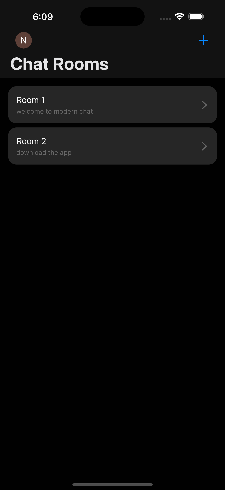
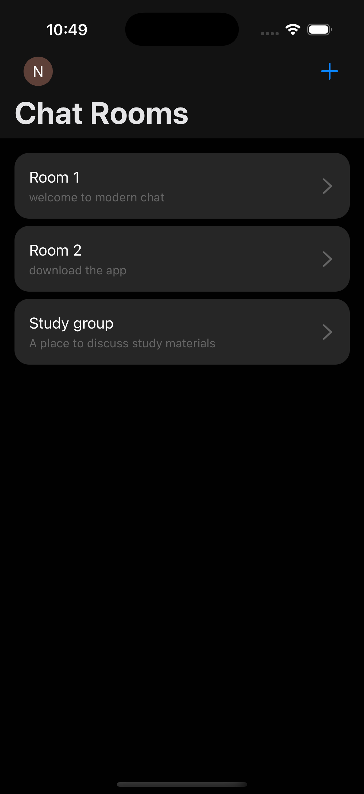
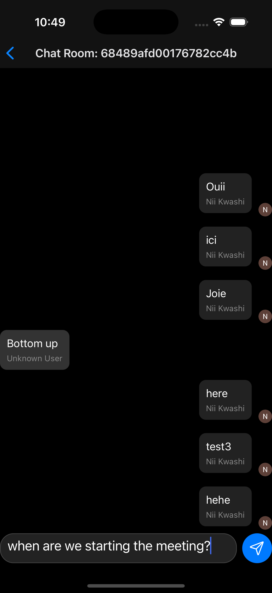

# Modern Chat

Modern Chat is a cross-platform chat client for iOS, Android, and the web. After signing in, a person can browse chat rooms, create a room, and send messages that are stored in Appwrite and refreshed from Appwrite realtime. Authentication is handled by Clerk, with Google sign-in and passkeys. It is a personal project by [Samuel Mensah](https://github.com/simiel).





A screen recording of the app is in [`media/recording.mp4`](media/recording.mp4).

## Features

- **Sign-in.** Google OAuth through Clerk, and discoverable passkey sign-in. Clerk API errors from Google sign-in are shown on the auth screen.
- **Session gating.** The `(auth)` and `(chat)` route groups redirect a signed-in user into chat and a signed-out user back to sign-in.
- **Profile.** Modal profile with avatar, name, email, username, and account dates, plus sign-out. Passkeys on the account can be created, listed, and deleted.
- **Rooms.** Loads up to 100 rooms from Appwrite, with pull-to-refresh. Creating a room requires a title (max 200 characters) and accepts an optional description.
- **Messages.** Opens a room by id and loads up to 100 messages, newest first from Appwrite, then displayed oldest to newest. The composer is multiline; send stays disabled while the text is empty or the first load is in progress.
- **Live thread.** Subscribes to the Appwrite messages collection and refetches the open room on each event. A sent message is appended locally before the document create finishes. The write stores `content`, `senderId` (the Clerk user id), and `chatroomId`, then updates the room document.
- **Conversation UI.** Dark theme, keyboard avoidance (header offset on iOS), and a Legend List aligned to the latest message. The signed-in user's bubble shows their Clerk name and avatar. Another sender's bubble shows `senderName`, or "Unknown User" when that field is absent. The send path does not write `senderName` or an avatar.

Passkeys are set up for a native build: `app.json` raises the iOS deployment target to 16.0, declares Clerk associated domains for app links and webcredentials, and registers the `modernchat` URL scheme.

## Tech stack

| Area | Choice |
| --- | --- |
| App | Expo SDK 53, React Native 0.79, React 19, TypeScript 5.8 |
| Navigation | Expo Router 5 (file-based routes, typed routes) and React Navigation 7 |
| Auth | `@clerk/clerk-expo`, `@clerk/expo-passkeys`, `expo-auth-session`, `expo-secure-store` |
| Data | Appwrite via `react-native-appwrite` 0.7 |
| UI | NativeWind 4, Tailwind CSS 3, Reanimated, Expo SF Symbols, Legend List (`@legendapp/list`) |
| Tooling | Yarn Classic 1.22, ESLint (`eslint-config-expo`), Prettier |

React Native's New Architecture is turned on (`newArchEnabled` in `app.json`). The web target uses Metro with static output.

## Architecture

```
app/
  _layout.tsx                  Clerk provider, token cache, passkeys, dark theme
  (auth)/index.tsx             Google and passkey sign-in
  (chat)/index.tsx             Room list
  (chat)/new-room.tsx          Create-room modal
  (chat)/profile.tsx           Profile and passkey management
  (chat)/[chat].tsx            Conversation
  (chat)/settings/[chat].tsx   Settings route (placeholder)
components/                    Button, Input, Text, IconSymbol
utils/appwrite.ts              Appwrite client and Databases
utils/types.ts                 ChatRoom, Message, and User types
utils/colors.ts                Shared colors
media/                         Screenshots and a screen recording
```

The root layout reads `EXPO_PUBLIC_CLERK_PUBLISHABLE_KEY` and wraps the router in `ClerkProvider` with Clerk's token cache, experimental passkeys, and the experimental resource cache. React Navigation's dark theme wraps the slot.

`utils/appwrite.ts` builds one `Client` and a `Databases` handle. Rooms and messages are documents in two collections. The open conversation subscribes to:

`databases.{databaseId}.collections.{messagesId}.documents`

and reloads that room's messages whenever an event arrives. `IconSymbol` uses SF Symbols on iOS and a Material Icons map on Android and web. NativeWind is wired through Metro (`withNativeWind` on `app/global.css`) and Babel (`jsxImportSource: 'nativewind'`, plus the Reanimated plugin).

## Getting started

### Prerequisites

- Node.js and Yarn Classic 1.22 (the `packageManager` field). Dependencies are locked in `yarn.lock`.
- A Clerk application with a publishable key, Google as an OAuth strategy, and passkeys enabled.
- An Appwrite project with a database and two collections the client writes to:
  - **Chatrooms:** `title`, `description`
  - **Messages:** `content`, `senderId`, `chatroomId`
- Xcode, for `yarn ios`. The iOS deployment target in `app.json` is 16.0.
- An Android SDK and a device or emulator, for `yarn android`.

### Install

```bash
yarn install
```

### Environment variables

Put these in `.env.local`. The names below are the only values the app reads. The checked-in `.env.local` lists the same names commented out. Keep live secrets out of git. The ignore rule for `.env*.local` in `.gitignore` is commented out, so that file is not ignored today.

| Variable | Required | Purpose |
| --- | --- | --- |
| `EXPO_PUBLIC_CLERK_PUBLISHABLE_KEY` | Yes | Clerk publishable key. Startup throws if it is missing. |
| `EXPO_PUBLIC_CLERK_APPWRITE_APP_ID` | Yes | Appwrite project id. The client throws if it is missing. |
| `EXPO_PUBLIC_CLERK_APPWRITE_DATABASE_ID` | Yes | Appwrite database id. |
| `EXPO_PUBLIC_CLERK_APPWRITE_CHATROOMS_ID` | Yes | Chatrooms collection id. |
| `EXPO_PUBLIC_CLERK_APPWRITE_MESSAGES_ID` | Yes | Messages collection id. |
| `EXPO_PUBLIC_CLERK_APPWRITE_ENDPOINT` | No | Appwrite endpoint. Defaults to `https://cloud.appwrite.io/v1`. |

The Appwrite client sets its platform to `test.simiel.modernchat`. The iOS bundle identifier and Android package in `app.json` are both `test.sam.modernchat`. Register, in the Appwrite console, the platform id of the client you run. The associated domains in `app.json` need to match the Clerk instance used for passkeys.

### Run

```bash
yarn start      # expo start
yarn ios        # expo run:ios
yarn android    # expo run:android
yarn web        # expo start --web
```

`yarn ios` and `yarn android` generate native projects. `ios/` and `android/` are gitignored.

### Lint

```bash
yarn lint       # expo lint
```

`package.json` also has `reset-project`, which runs `node ./scripts/reset-project.js`. That script is not in the repository. There is no test script.

## Project status

Personal prototype. Sign-in, the room list, room creation, messaging, realtime refresh, and the profile screen are implemented.

The settings screen (`app/(chat)/settings/[chat].tsx`) only renders a "Chat Settings" label. Nothing in the current UI navigates to it.

`passkey_issue.txt` records an iOS passkey registration failure: AuthenticationServices error 1004, because the app identifier was not associated with the Clerk domain (`passkey_registration_failed`). `log` notes that iOS signing was done with a personal Apple Developer account.

## What this demonstrates

- **Auth in an Expo app.** Google OAuth with an AuthSession redirect, Clerk session activation, a cached Clerk token, and passkeys end to end: discoverable sign-in, create, list, and delete, plus the iOS 16 deployment target and associated domains that passkeys require.
- **A document chat backend.** Typed Appwrite collections, bounded list queries, creates and updates, and a realtime subscription that reloads the open thread, with an optimistic message append on send.
- **Mobile app structure.** File-based routing with auth and chat groups, modal profile and room-creation screens, a keyboard-aware composer, and a virtualized message list anchored to the latest message.
- **Cross-platform setup.** The React Native New Architecture, typed Expo Router routes, NativeWind, and platform-specific icons (SF Symbols on iOS, Material Icons on Android and web).
